# USERDATA — Software Design Document

Draft 2, 2026-10-30, amended after Phase 0 build. Schema as built: `SCHEMA.md`. Draft 1 and its review are in
`archive/SDD-draft1.md` and `REVIEW-1.md`.

Contents: 1 Problem · 2 Load · 3 Use cases · 4 The one rule · 5 ERD and
rationale (5.6 is the research account: watchlists, peer groups, searches, notes) · 6 Sequence diagrams · 7 Transactions and invariants · 8 Physical
design now and later · 9 Evolution · 10 Decisions.

---

## 1. Problem

The tools exist. `edgartools` reads EDGAR and parses XBRL. `yfinance` reads
prices and fundamentals. Arelle validates taxonomies. Claude can call them all.
None of them keeps anything for the user. Yahoo Finance gives a logged-in user an
account: history, saved screens, watchlists, settings. USERDATA is that account for
Michael's work with Claude, done properly. It is the user's durable store,
exposed as MCP tools, used from Claude Desktop and Claude Code.

v1 runs on SQLite and DuckDB. Postgres, ClickHouse, dbt, Airflow, Unity Catalog,
NiFi and Superset come later and must slot in without rework. Permissive
licences only. Every write survives a kill and restart.

---

## 2. Load (DDIA ch. 1, "Describing Load")

Design load, not launch load. Numbers are for 100 companies followed over 3 years.

| What | Estimate | Basis |
|---|---|---|
| Issuers, securities, listings | 100 / 150 / 200 | some issuers have two share classes or more than one listing |
| Filings per issuer per year | 30 | 10-K, 3×10-Q, ~15 8-K, Form 4s, 13G, S-1 or S-3 when they raise money |
| Filings total | 9 000 | |
| XBRL facts per 10-K / 10-Q | 2 500 / 1 000 | typical edgartools output, with dimensions |
| Facts total (reported) | ~1.7 M | 100 × 3 × (2 500 + 3 000) |
| Facts total (derived + manual) | ~50 k | own concepts are few; per issuer per period |
| Chunks per 10-K / 10-Q / 8-K | 1 200 / 400 / 30 | ~500 tokens per chunk |
| Chunks total | ~900 k | ~2 KB text each → ~1.8 GB text |
| Embeddings | 900 k × 384 floats | ~1.4 GB; brute-force cosine scans in ~1 s on DuckDB |
| Price rows | 150 k | 200 listings × 252 days × 3 years |
| Ratios | ~200 k | 100 issuers × 12 quarters × ~150 ratio-method pairs |
| Events (user-authored changes) | ~20 k per year | preferences, tags, theses, questions, skill edits |
| Skill runs | ~5 k per year | |
| Sessions | ~1 k per year | |
| Searches | ~5 k per year | |
| Watchlists / peer groups / notes | 10s / 10s / 1 k per year | |

Consequence: everything above 100 k rows is columnar and append-mostly, so it
goes in DuckDB. Everything authored by a person or by Claude is small, needs
transactions and history, so it goes in SQLite. Chunk text is 1.8 GB, so it is
DuckDB, not SQLite.

---

## 3. Use cases

Actors: **Michael** (owns meaning), **Claude** (does the work), **Skill** (a
versioned procedure Claude runs), **Scheduler** (Airflow, later). Every write
records which actor made it.

| # | Use case | Actor | Writes to |
|---|---|---|---|
| 1 | Start and end a session; record notes, decisions, artifacts | Claude | event, session |
| 2 | Set a preference; see what was in force at a past date | Michael | event, preference_current |
| 3 | Register a skill; publish a new version; install it to disk | Michael, Claude | skill, skill_version, blob |
| 4 | Run a skill; store inputs, report, artifacts, and the preferences in force | Skill | skill_run, skill_report |
| 5 | Pull EDGAR / Yahoo / FIGI data; cache it; load it once | Claude, Scheduler | source_call, raw_payload, fact, price_daily, chunk |
| 6 | Resolve CIK ↔ ticker ↔ FIGI at a date; record company relations and corporate actions | Claude | issuer, security, listing, identifier_assignment, entity_relation, corporate_action |
| 7 | Define an own XBRL concept and its formula; validate with Arelle; publish | Michael | taxonomy_version, concept_version, concept_mapping |
| 8 | Derive own-concept facts from reported facts; compare | Skill | fact (origin=derived), fact_input |
| 9 | Type a number by hand as an own-concept fact | Michael | manual_fact → fact (origin=manual) |
| 10 | Tag a document, chunk or fact with an own tag | Michael, Skill | tag, *_tag |
| 11 | Compute ratios by versioned method; run a screen | Skill | ratio, ratio_input, screen_result |
| 12 | Semantic search over filing chunks with filters | Claude | reads chunk_embedding |
| 13 | Open, revise, close a thesis; add claims with kill criteria | Michael | thesis, thesis_version, thesis_claim |
| 14 | Queue a research question; work it step by step; answer with evidence | Michael, Claude | research_question, research_step, research_answer, evidence |
| 15 | A fact is restated: find every claim that cited it | Claude | reads evidence, fact |
| 16 | Rebuild every derived table from raw + events + code | Scheduler | all DuckDB tables |
| 17 | Save a screen; run it; score every company | Michael, Skill | screen_version, screen_result |
| 18 | Build a peer group by hand, by SIC, or from a screen | Michael, Claude | peer_group, peer_group_member |
| 19 | Keep watchlists; see when and why a company was added or dropped | Michael | watchlist, watchlist_item |
| 20 | See my search history; save and rerun a search | Michael | search_history, saved_search |
| 21 | Write notes on a company; compare peers side by side | Michael, Claude | company_note, comparison |
| 22 | Start a project; put sessions, theses, lists, notes and runs under it; pick it up days later | Michael, Claude | project |

---

## 4. The one rule: record or derived

DDIA Part III: decide for every piece of data whether it is the **system of
record** (SoR) or **derived** from something else. Draft 1 did not. Draft 2
does, table by table.

- **SoR** = cannot be rebuilt. Authored by Michael or Claude, or fetched once
  from outside and immutable (raw payloads). Lives in SQLite, later Postgres.
  Backed up. History kept.
- **Derived** = a pure function of (SoR data, raw payloads, code version). Lives
  in DuckDB, later ClickHouse. Rebuildable by replay. Not backed up.
- **Reference** = fetched from outside but curated (identity, relations). SoR
  with a `source_call_id` saying where each row came from.

Writes follow DDIA ch. 11 and 12, not dual writes:

1. A tool call is a **command**. It commits **one SQLite transaction**: the
   `event` row (the truth), the SoR or projection rows, and an `outbox` row if
   DuckDB must be updated.
2. A **projector** reads the outbox and loads DuckDB **idempotently**, keyed on
   natural keys, and writes a `load_log` row in the same DuckDB transaction.
3. A cache hit means the `load_log` row exists for (payload, code version,
   table), not just that `source_call` says "fetched".
4. Files on disk (taxonomy `.xsd`, skills in `~/.claude/skills`, report files)
   are **exports** of database rows, never the other way round.

Two projections are allowed to be synchronous for simplicity: `session` and
`preference_current` are written in the same SQLite transaction as their event.
A replay test rebuilds them from `event` and must match.

Cross-store references (SQLite row → DuckDB row, or back) cannot be foreign
keys. They use **deterministic ids** (sha256 of the natural key), are checked
for existence at write time, and are re-checked by a nightly integrity query.
ClickHouse has no foreign keys either, so this is the habit from day one.

---

## 5. ERD and rationale (DDIA ch. 2, 3, 4, 7, 11)

Five domains. Each diagram shows its SQLite tables and the DuckDB tables it
references. DuckDB tables are named in the diagram with the comment
`"DuckDB"` on their id column. Relationships labelled `xstore` cross the store
boundary and are deterministic ids, not foreign keys.

Every id is either a deterministic hash of the natural key (written as
`sha256(...)`) or a UUIDv7 (time-ordered, so B-tree inserts stay sequential,
DDIA ch. 3). Dates are ISO-8601 UTC text with a `Z` suffix in SQLite, enforced
by `CHECK`, and real `DATE` / `TIMESTAMP` in DuckDB.

### 5.1 Identity and reference

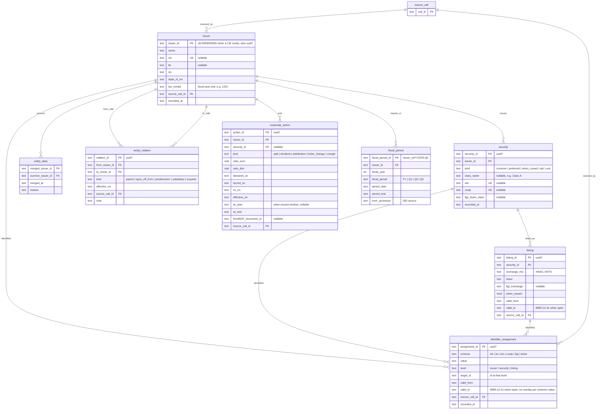

| Table | Kind | For | Read how | Rows | Shape and why |
|---|---|---|---|---|---|
| `issuer` | Reference | the legal filer | by id; by CIK; by name search | 100s | Relational. The id is the CIK when there is one, so resolving the same company by ticker and later by CIK cannot mint two rows (DDIA ch. 2: ids separate from human-meaningful values; ch. 11 idempotence). |
| `security` | Reference | one instrument of an issuer | by issuer | 100s | Relational, 1:N from issuer. ISIN, CUSIP and share-class FIGI live here, not on the issuer, because GOOG and GOOGL are two securities of one issuer. |
| `listing` | Reference | one ticker on one exchange, over time | by (ticker, exchange, date); by security | 100s | Relational, 1:N from security, temporal. Prices and ratios key on listing, because two listings of one security can trade at different prices on the same day. |
| `identifier_assignment` | Reference | every external id, at its real level, with validity | find target by (scheme, value, date) | 1 000s | One table for all schemes so the no-overlap rule is one trigger: a ticker cannot belong to two targets on the same day. Knowledge time is `recorded_at` + `source_call_id`; full bitemporal queries are not needed here (DDIA ch. 11, event time vs processing time). |
| `entity_alias` | SoR | merge two issuers found to be one | by merged id on every lookup | 10s | Without it, a wrong early resolution can never be repaired without rewriting keys. |
| `entity_relation` | Reference | how companies relate | children of X; parents of X; path | 100s | Graph as edge table, walked with a recursive CTE (DDIA ch. 2, graph in SQL). Same pattern as concept relations. |
| `corporate_action` | Reference | splits, dividends, ticker changes, mergers, distributions | by issuer and date | 100s | This is what makes `adj_close` checkable and what dates a corporate action took effect. Form 8937 cost-basis allocation points at its document. |
| `fiscal_period` | Derived | what "FY2025 Q2" means for this issuer | by id from facts | 1 000s | Derived from DEI `DocumentFiscalPeriodFocus`. Small enough for SQLite, needed as a key by DuckDB facts, so the id is deterministic. Solves non-December year ends and 52/53-week years. |

### 5.2 Authored state: events, sessions, preferences, skills

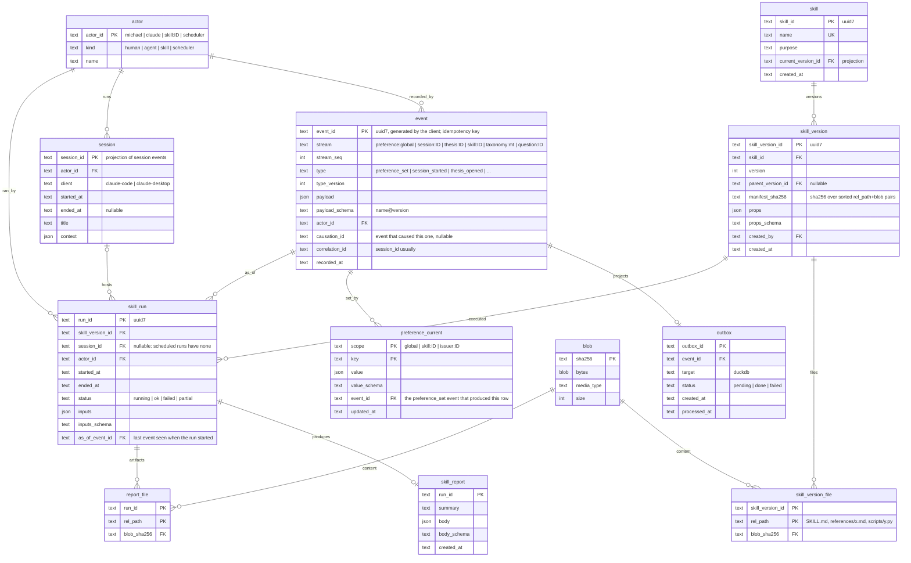

| Table | Kind | For | Read how | Rows | Shape and why |
|---|---|---|---|---|---|
| `event` | **SoR** | every change Michael or Claude makes | by stream in order; replay all | 20 k/yr | Event sourcing (DDIA ch. 11): the log is the truth, tables are caches of it. `event_id` is generated by the client so MCP retries are idempotent. `type_version` is the upcasting hook. `actor` answers "who decided this". No snapshots: the log is small enough to replay in seconds. |
| `outbox` | SoR | hand events to the DuckDB projector | pending by created_at | small, churns | Transactional outbox (DDIA ch. 11, "Keeping systems in sync"): written in the same transaction as the event, so DuckDB can never miss a change and never sees one that was rolled back. |
| `actor` | SoR | who | by id | 10s | Michael, Claude, each skill, the scheduler. Every SoR row carries one. |
| `session` | Projection | a working session | by id; recent | 1 k/yr | Rebuilt from `session_started` / `session_ended` / `session_titled` events. Synchronous projection for simplicity. |
| `preference_current` | Projection | what is in force now | by (scope, key); all in scope | 100s | The history is in `event`. "What did Claude know about Michael when it wrote this report" = events in `preference:*` streams up to `skill_run.as_of_event_id`. Scope makes a preference global, per skill or per issuer. |
| `skill` | SoR | a skill's identity | by name | 10s | `current_version_id` is a projection of `skill_published` events. |
| `skill_version` | **SoR** | one immutable version of a skill | latest per skill; by id from a run | 100s | Insert-only. Database is the source of truth for skills; the folder in `~/.claude/skills` is an export. `parent_version_id` gives the lineage of edits. Props are a document with a schema id (DDIA ch. 4). |
| `blob` | **SoR** | bytes, content-addressed | by hash | 1 000s | One store for skill files and report artifacts. Identical files stored once. |
| `skill_version_file` | SoR | the bundle | all files of a version | 1 000s | A skill is SKILL.md plus references plus scripts. One row per file. |
| `skill_run` | **SoR** | the lineage anchor | by id; by skill; by session | 5 k/yr | Facts, ratios, taggings, source calls and research steps point back here. `as_of_event_id` pins the preferences and skill text that were in force. |
| `skill_report` | SoR | what the run concluded | by run | 5 k/yr | Document: written once, read whole. Artifacts go to `blob` via `report_file`, never to a path. |

### 5.3 Concepts and facts

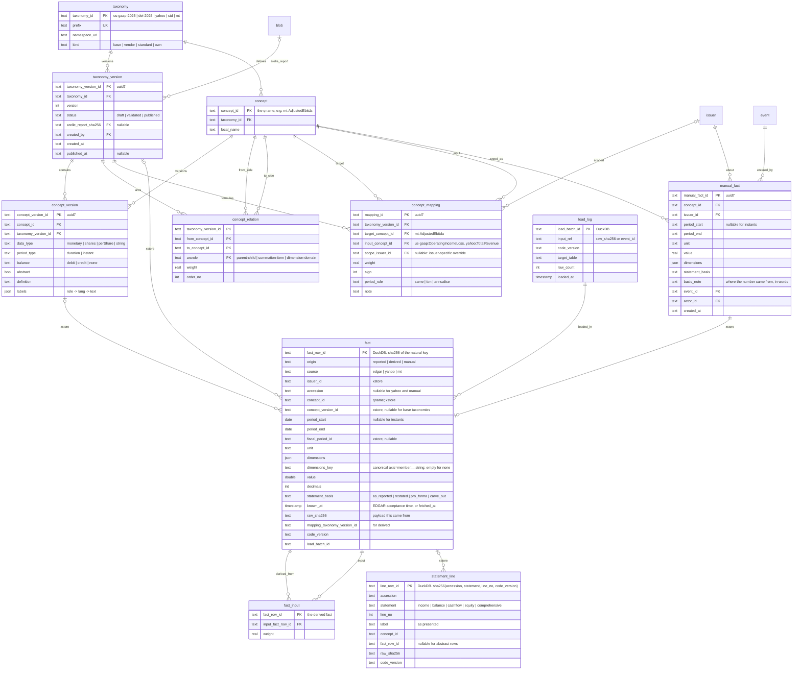

| Table | Kind | For | Read how | Rows | Shape and why |
|---|---|---|---|---|---|
| `taxonomy` | SoR | a namespace | by prefix | 5 | Base (us-gaap, dei), vendor (yahoo line items), standard (edgartools' standardised labels) and own (`mt`) are all taxonomies. That is what lets an `mt` arc point at a `us-gaap` concept. |
| `taxonomy_version` | **SoR** | a validated snapshot of a taxonomy | published per taxonomy; by id from a fact | 10s | Draft → validated by Arelle → published. Only published versions can be referenced by mappings and facts (DDIA ch. 7: invariants as constraints). Arelle's report is kept as a blob. |
| `concept` | SoR | a concept's identity | by qname | 20 k | Base taxonomies are loaded so arcs, mappings and facts have something to reference. The id is the qname, so it is deterministic. |
| `concept_version` | **SoR** | what a concept meant in one taxonomy version | by concept; by version | 20 k | Insert-only. Editing a definition cannot change the meaning of old facts, because they point at the old version. |
| `concept_relation` | SoR | the taxonomy graph | children; parents; calculation tree | 50 k | Graph as edge table, keyed by taxonomy version. Recursive CTE in SQLite and Postgres. |
| `concept_mapping` | **SoR** | **the formula as data** | all inputs of a target; all targets using an input | 100s | `mt:AdjustedEbitda = +1 × us-gaap:OperatingIncomeLoss +1 × mt:OneOffCosts`. One row per input. `scope_issuer_id` allows a per-company override. Derived facts are a pure function of this table plus reported facts plus code version (DDIA ch. 10). The reverse lookup "which own concepts depend on this us-gaap concept" is a plain join. |
| `manual_fact` | **SoR** | a number Michael typed | by concept and issuer | 1 000s | Hand-entered values cannot be rebuilt, so they are SoR in SQLite, with the event that entered them. Projected into `fact` with `origin=manual`. |
| `fact` | **Derived** | **one long table for every number**, reported or derived or manual | by issuer, concept, period; by concept across issuers; latest vs as-first-reported | 1.7 M | DDIA ch. 3: the narrow fact table is the columnar shape; DDIA ch. 2: one family of data in one place so comparisons are a join, not a cross-engine union. `known_at` + `accession` give point-in-time reads: `fact_latest` and `fact_as_of(date)` views (ch. 11, event time vs processing time). `statement_basis` separates pro forma and carve-out numbers from as-reported ones. `dimensions_key` is the canonical string so dimensions can be part of the key and, later, of the ClickHouse `ORDER BY`. |
| `fact_input` | Derived | lineage of a derived fact | inputs of X; what was built from Y | 100 k | Which reported rows went into an own-concept value. Auditable without recomputing. When a fact is restated, this finds every derived fact to recompute. |
| `statement_line` | Derived | how a filing presented its numbers | by accession and statement, in order | 500 k | Presentation is separate from facts (that is how XBRL itself is built). "Tag a statement line" means tagging the fact the line shows. |
| `load_log` | Derived | proof that a payload was loaded by a code version | by (input_ref, code_version, table) | 10 k | Written in the same DuckDB transaction as the rows. The cache check reads this, not `source_call`. A parser fix means: find batches with the old code version, reload only those (DDIA ch. 10, reproducible batch outputs). |

**Natural keys** (what `fact_row_id` hashes):

| origin / source | natural key |
|---|---|
| reported / edgar | accession, concept_id, period_start, period_end, unit, dimensions_key |
| reported / yahoo | raw_sha256, concept_id, period_end, dimensions_key |
| derived / mt | mapping_taxonomy_version_id, target concept_id, issuer_id, period_start, period_end, unit, dimensions_key, code_version, sorted input fact_row_ids |
| manual / mt | manual_fact_id |

### 5.4 Tags, theses, research, evidence

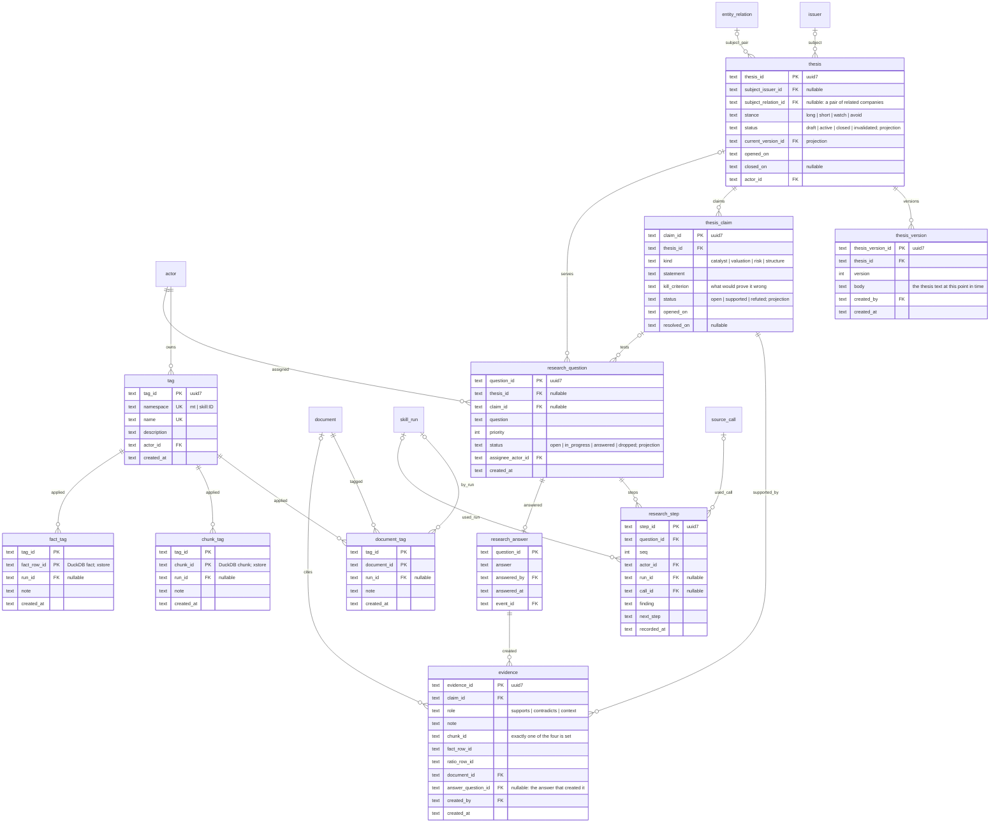

| Table | Kind | For | Read how | Rows | Shape and why |
|---|---|---|---|---|---|
| `tag` | SoR | an own label | by (namespace, name) | 100s | Namespace separates Michael's tags from skill-generated ones. |
| `document_tag`, `chunk_tag`, `fact_tag` | SoR | tag applied to one kind of target | tags of X; targets with tag T | 10 k | One join table per target kind, not `target_kind + target_id` (DDIA ch. 2: the relational model needs real references; polymorphic ids give no integrity and different queries per kind). `document_tag` has a true FK. The other two cross the store and use deterministic ids. |
| `thesis` | SoR | one investment idea | active list; by subject | 10s | Subject is an issuer or a relation between two issuers. Status and current version are projections of thesis events. |
| `thesis_version` | **SoR** | what Michael believed at a date | latest; diff two | 100s | Insert-only. History is the product (DDIA ch. 11). Same pattern as `skill_version`. |
| `thesis_claim` | SoR | one testable statement with its kill criterion | claims of a thesis; open claims everywhere | 100s | Claims are rows, not paragraphs, because research works against them one by one. |
| `evidence` | **SoR** | one link from a claim to a source | evidence for a claim; **which claims cite this fact or chunk** | 1 000s | M:N between claims and sources, with an exclusive arc: `CHECK` exactly one of `chunk_id`, `fact_row_id`, `ratio_row_id`, `document_id` is set. The reverse lookup is the reason it is relational: when a fact is restated, every claim that cited it must surface (use case 15). |
| `research_question` | SoR | the unit of research work | open queue by priority; by thesis | 100s | A queue Claude picks from in every session without being re-told. |
| `research_step` | **SoR** | what was done for a question | steps in order | 1 000s | Append-only log keyed by question. Points at the skill run or source call it used. The trail is the product. |
| `research_answer` | SoR | closes a question | by question | 100s | 1:1 with an answered question. Kept separate so answering is one transaction: answer + evidence + status event together (DDIA ch. 7). |

### 5.5 Documents, cache, chunks, prices, ratios, screens

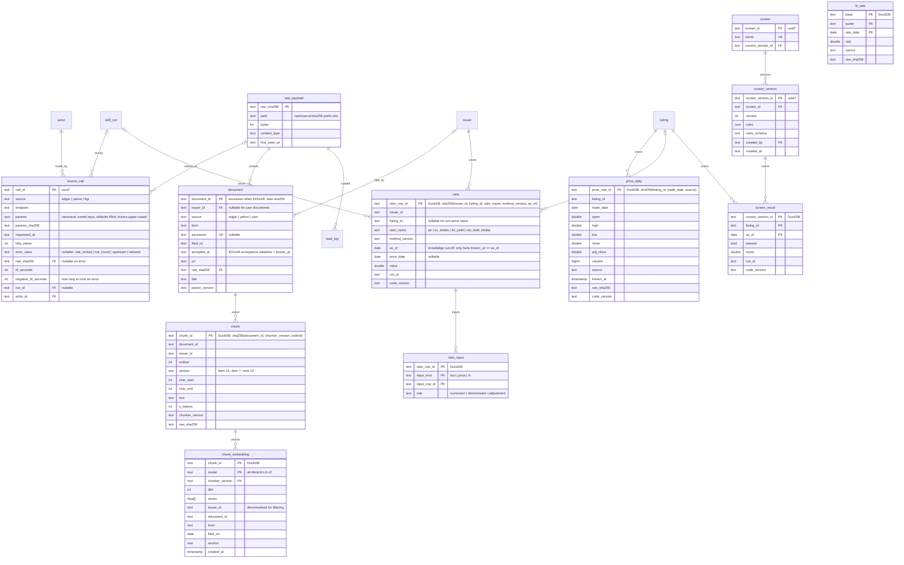

| Table | Kind | For | Read how | Rows | Shape and why |
|---|---|---|---|---|---|
| `source_call` | SoR | every outside call, success or error | latest successful by params hash; errors within negative TTL | 50 k/yr | Many calls to one payload (`}o--o|`): content addressing means a re-fetch that returns the same bytes adds a call row, not a payload. Two different payloads for the same params is how a Yahoo revision becomes visible. Params are canonicalised by one tested function, or the hash misses. |
| `raw_payload` | **SoR** | the bytes as received, never edited | by hash | 30 k | Immutable inputs plus versioned code equals reproducible outputs (DDIA ch. 10). Everything in DuckDB can be rebuilt from here plus `event`. Copied to B2 by rclone, because one disk is not durable. |
| `document` | Derived | a filing or user document | by issuer and form; by accession | 10 k | Small, keyed by accession, referenced by FKs from `evidence` and `document_tag`, so it lives in SQLite although it is derived. `accepted_at` is the knowledge time for all its facts. |
| `chunk` | Derived | the text unit | by id from a search hit; by document in order | 900 k | 1.8 GB of text is a columnar store's job. `char_start/end` anchor citations. `chunker_version` in the id so a new chunker is additive. |
| `chunk_embedding` | Derived | the vector index | nearest k with filters | 900 k | Filter columns are **denormalised in** (issuer, form, date, section) because a vector index must carry what its readers filter on (DDIA ch. 3, ch. 12). Otherwise every search joins across stores or post-filters to fewer than k. Key includes model and chunker version so re-embedding is additive. v1 brute-force cosine: no index to persist, so rule 2 holds trivially. |
| `price_daily` | Derived | prices per listing per day | range by listing and date | 150 k | Keyed by listing, not issuer (when-issued vs regular way). `known_at` + `raw_sha256` make revisions visible instead of overwriting. |
| `fx_rate` | Derived | currency conversion | by pair and date | 10 k | Facts are stored in reporting currency; ratios convert at computation time and record the fx row they used. |
| `ratio` | Derived | a computed number by a named method | by issuer and as_of; one ratio across issuers | 200 k | Computed by versioned code from `fact` and `price_daily`. Claude picks the method, it does not supply numbers. `as_of` is the knowledge cut-off, so a screen as of a past date has no look-ahead (DDIA ch. 11). |
| `ratio_input` | Derived | every number a ratio used | inputs of a ratio; ratios using a fact | 1 M | Child table, not JSON: the reverse lookup "which ratios used this restated fact" needs rows. |
| `screen`, `screen_version` | SoR | a screen definition, versioned | current; by id from a result | 10s | Rules are a document with a schema id. Insert-only versions, same as skills and theses. |
| `screen_result` | Derived | pass/fail and score per listing per date | by screen and date | 100 k | Rebuildable from ratios and the screen version. |

### 5.6 The research account: watchlists, peer groups, searches, notes, comparisons

This is the part a Yahoo Finance account gives you, done properly: what you
watch, who you compare against, what you searched, what you wrote. All SoR in
SQLite, all changed through events, so every list has a history.

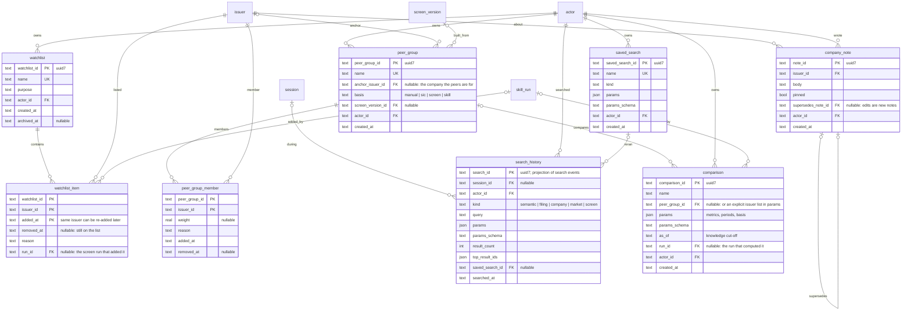

| Table | Kind | For | Read how | Rows | Shape and why |
|---|---|---|---|---|---|
| `watchlist`, `watchlist_item` | **SoR** | what you follow, and since when | items of a list; lists containing X; what was dropped and why | 10s / 100s | `added_at` is part of the key and `removed_at` is a column, so a drop is not a delete: "when did I drop it and why" stays answerable (DDIA ch. 11, immutability). An item can point at the screen run that put it there. |
| `peer_group`, `peer_group_member` | **SoR** | who you compare a company against | members of a group; groups containing X | 10s / 100s | A group has an anchor company and a basis: by hand, by SIC code, from a screen, or from a skill. Membership keeps `removed_at` like watchlists. Weight allows weighted peer medians later. |
| `search_history` | Projection | your history of searches | recent; by session; by kind; by company | 5 k/yr | Projected from `search_performed` events, so it is rebuildable and the event log stays the truth. `top_result_ids` lets you reopen what you found without re-running. |
| `saved_search` | SoR | a search you want to rerun | by name | 10s | Params are a document with a schema id, same as screens. A rerun writes a `search_history` row pointing back here. |
| `company_note` | **SoR** | what you wrote about a company | notes of a company, newest first; pinned | 1 k/yr | Insert-only. An edit is a new note that supersedes the old one, so nothing you wrote is ever lost. |
| `comparison` | SoR | a saved side-by-side | by name; by peer group | 100s | The definition is the record. The numbers come from `ratio` and `fact` at `as_of`, so a comparison is reproducible and never stale: it recomputes from the same cut-off. |

**Project.** A `project(project_id, name, goal, status active|paused|closed, actor_id,
created_at, closed_at)` row is the container Michael starts work in. `session`,
`thesis`, `watchlist`, `peer_group`, `research_question`, `skill_run`, `comparison`,
`company_note`, `saved_search` and `screen` carry a nullable `project_id`. "The
project we started yesterday" is one join. SoR, event-driven like the rest.

Room for more: alerts, portfolios, valuation models, and reading lists are new
tables in the same pattern (SoR, event-driven, `actor_id`, insert-only history).
They are additive and need no change to anything above.

---

## 6. Sequence diagrams

Each note names the transaction boundary.

### 6.1 Skill run with cached pull, projector, ratios

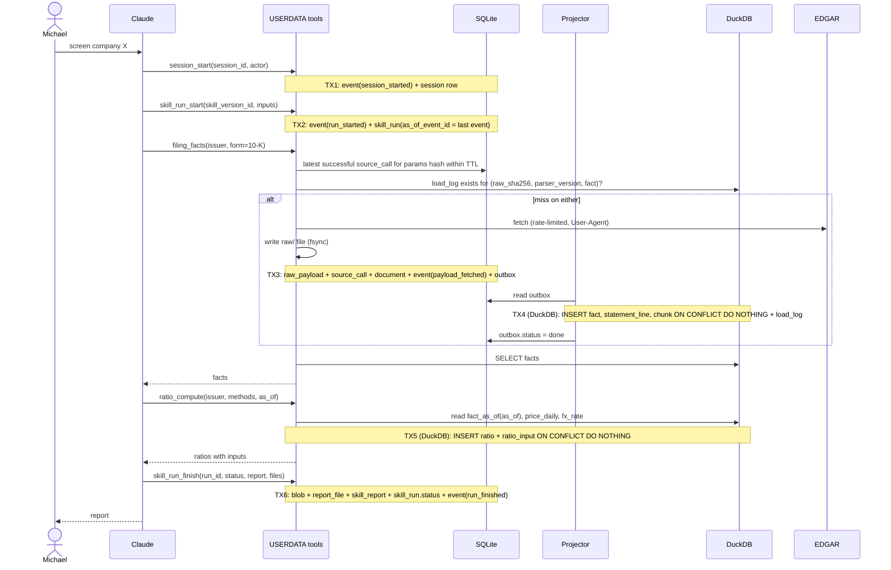

### 6.2 Michael defines an own concept, publishes it, derives facts

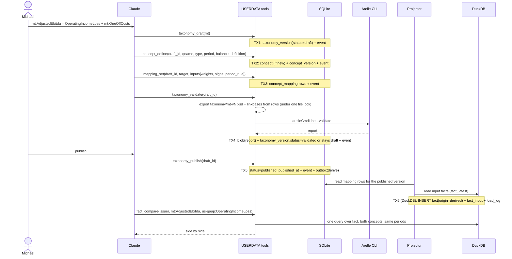

### 6.3 Thesis, claim, research question, answer with evidence

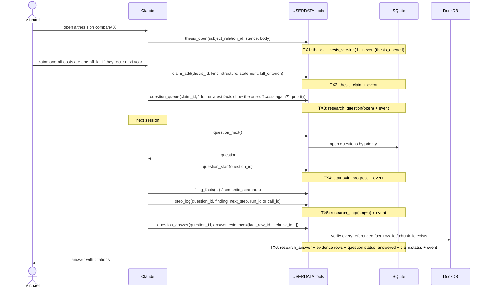

### 6.4 A fact is restated: who cited it

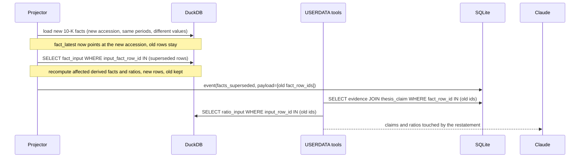

### 6.5 Semantic search with filters

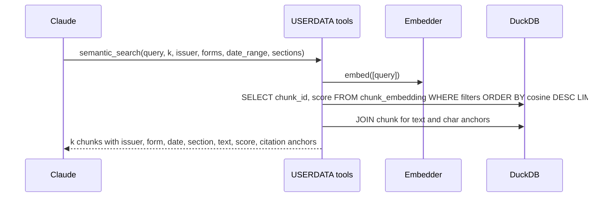

### 6.6 Screen, score, peer group, watchlist, comparison

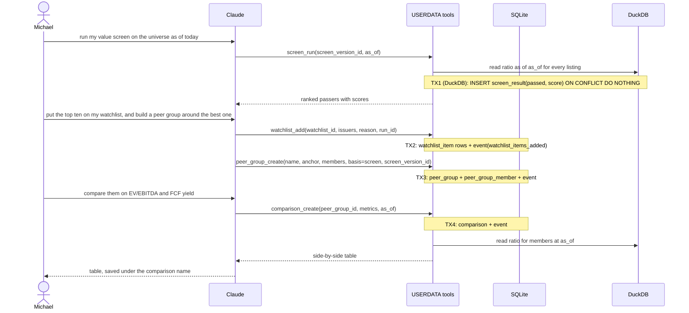

---

## 7. Transactions and invariants (DDIA ch. 7)

Single user is not single writer: Claude issues parallel tool calls, and
Airflow writes later. Every invariant is a database constraint, not an
application check, because Postgres defaults to read committed and
check-then-insert gets write skew there.

| Invariant | Enforced by |
|---|---|
| One event per (stream, stream_seq) | `UNIQUE(stream, stream_seq)`; writer uses `BEGIN IMMEDIATE` and `MAX+1` |
| An MCP retry does not double-write | `event_id` is client-generated; `INSERT OR IGNORE`, then return the existing result |
| One preference per (scope, key) | PK |
| A ticker belongs to one target at a time, per exchange | trigger on `identifier_assignment` rejecting overlapping `[valid_from, valid_to)` per (scheme, value, exchange); Postgres: `EXCLUDE USING gist` |
| A concept has one version per taxonomy version | `UNIQUE(concept_id, taxonomy_version_id)` |
| Only published taxonomy versions are referenced by facts and mappings | `CHECK` via trigger on insert into `concept_mapping`; projector reads only `status=published` |
| Evidence points at exactly one source | `CHECK ((chunk_id IS NOT NULL) + (fact_row_id IS NOT NULL) + (ratio_row_id IS NOT NULL) + (document_id IS NOT NULL) = 1)` |
| A skill version is never edited | no `UPDATE` grant on `skill_version`, `thesis_version`, `concept_version`, `research_step`, `event`, `raw_payload`; triggers raise on `UPDATE`/`DELETE` |
| DuckDB rows are never duplicated | every table has a natural-key PK; loads use `INSERT ... ON CONFLICT DO NOTHING` |
| Cross-store references exist | checked at write; nightly query lists orphans |

Transaction boundaries per tool are the `Note over` lines in §6. Every SQLite
read-modify-write opens with `BEGIN IMMEDIATE` so it cannot hit `SQLITE_BUSY`
mid-transaction. Taxonomy file export runs behind one process-wide lock.

---

## 8. Physical design, now and later (DDIA ch. 3)

### 8.1 SQLite now, Postgres later

`journal_mode=WAL`, `synchronous=FULL` (rule 2 means power loss too, not just a
kill), `foreign_keys=ON`, files `chmod 600` in a `chmod 700` directory.
Postgres gets the same DDL with `jsonb` for JSON columns, `timestamptz` for
dates, `bytea` for blobs, and the gist exclusion constraint for identifiers.
Repositories for this family are written once against SQL that both accept.

### 8.2 DuckDB now, ClickHouse later

DuckDB has no declared sort key; the loader inserts in key order and zone maps
do the rest. ClickHouse needs the table engine chosen now, because `ORDER BY`
cannot change without a rebuild.

| Table | Natural key = DuckDB PK | ClickHouse engine | ORDER BY | PARTITION BY | Version column |
|---|---|---|---|---|---|
| `fact` | fact_row_id (hash of §5.3 key) | MergeTree (append-only: restatements are new rows) | issuer_id, concept_id, period_end, known_at | toYear(period_end) | none |
| `fact_input` | fact_row_id, input_fact_row_id | MergeTree | fact_row_id | none | none |
| `statement_line` | line_row_id | ReplacingMergeTree | accession, statement, line_no | toYear(filed) | code_version |
| `chunk` | chunk_id | MergeTree | document_id, ordinal | toYear(filed_on) | none |
| `chunk_embedding` | chunk_id, model, chunker_version | MergeTree + vector similarity index (HNSW) | issuer_id, document_id, chunk_id | none | none |
| `price_daily` | price_row_id = sha256(listing_id, trade_date, source, raw_sha256); `price_latest` view picks newest known_at | MergeTree (revisions are new rows) | listing_id, trade_date, known_at | toYYYYMM(trade_date) | none |
| `fx_rate` | base, quote, rate_date, raw_sha256; `fx_rate_latest` view | MergeTree | base, quote, rate_date, known_at | toYear(rate_date) | none |
| `ratio` | ratio_row_id | MergeTree | issuer_id, ratio_name, as_of | toYear(as_of) | none |
| `ratio_input` | ratio_row_id, input_kind, input_row_id | MergeTree | ratio_row_id | none | none |
| `screen_result` | screen_version_id, listing_id, as_of | ReplacingMergeTree | screen_version_id, as_of, listing_id | toYear(as_of) | code_version |
| `load_log` | load_batch_id | MergeTree | input_ref, code_version | none | none |

ReplacingMergeTree deduplicates at merge time, so readers use `FINAL` or
`argMax`. Rows the design never updates use plain MergeTree.

Repositories are split by family: OLTP repos (SQLite / Postgres) and OLAP repos
(DuckDB / ClickHouse). Dialect differences inside a family are small; across
families they are not, so no single `execute(sql)` interface pretends
otherwise. SQLGlot (MIT) transpiles where it helps.

Later tools and the single DuckDB writer: the MCP server's projector is the only
writer to `analytics.duckdb`. dbt writes to its own file or schema; Superset and
notebooks open the file `read_only`. On ClickHouse this constraint disappears.

### 8.3 Vector search

v1: `chunk_embedding.vector` as `FLOAT[384]`, `array_cosine_similarity`, brute
force with filters pushed down. ~1 s over 900 k rows. No index, nothing to
persist, rule 2 holds. Later: ClickHouse vector similarity index. The
`VectorStore` interface is `upsert(rows)`, `search(vector, k, filters)`, and the
filter columns are the denormalised ones in §5.5.

---

## 9. Evolution (DDIA ch. 4)

1. **Additive only.** New columns are nullable or defaulted. Removal is
   two-step: stop writing, drop a version later.
2. **Every JSON column has a schema id** next to it (`*_schema = name@version`),
   with JSON Schema files in `schemas/`. Readers handle version N and N−1; CI
   tests both. Schema-on-read still needs the writer's schema (Avro's lesson).
3. **Events are versioned** (`type_version`) and upcast on read. Replay of the
   whole log into fresh projections is a CI test.
4. **Long tables absorb new concepts.** A new ratio, line item or concept is a
   row, not a column.
5. **Versioned migrations** per store: `migrations/oltp/0001_*.sql` and
   `migrations/olap/0001_*.sql`, with a `schema_migration` table in each.
6. **Names are dbt-ready.** These tables are the `core` layer; dbt marts build
   on top. Unity Catalog name: `userdata.core.<table>`.
7. **Code version on every derived row** so a parser or method fix reloads only
   what it touched.

---

## 10. Decisions for Michael

1. **Data directory**: `~/Slop/userdata-data/` (recommended) or inside the repo.
2. **Embedding model**: `all-MiniLM-L6-v2` (Apache-2.0, fast) or
   `bge-small-en-v1.5` (MIT, better retrieval). Both 384 dims.
3. **MCP framework**: FastMCP 4 (Apache-2.0) or the official SDK's FastMCP
   (MIT). Your Yahoo fork uses the official SDK.
4. **Own taxonomy prefix**: `mt`.
5. **Base taxonomies to load**: us-gaap and dei for the years you follow
   (2023–2025), or only the concepts that appear in your filings.
6. **`unidecode` in the edgartools fork**: replace with `anyascii` (ISC) now.
7. **Chunk text in DuckDB, not SQLite**: agree, or keep text next to tags.
