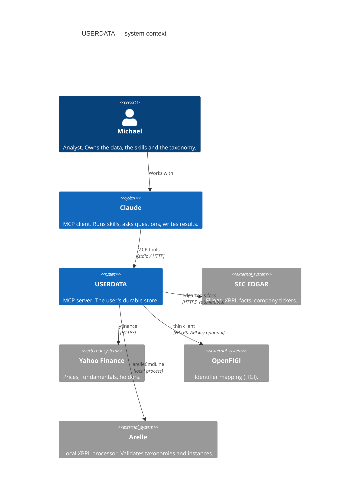
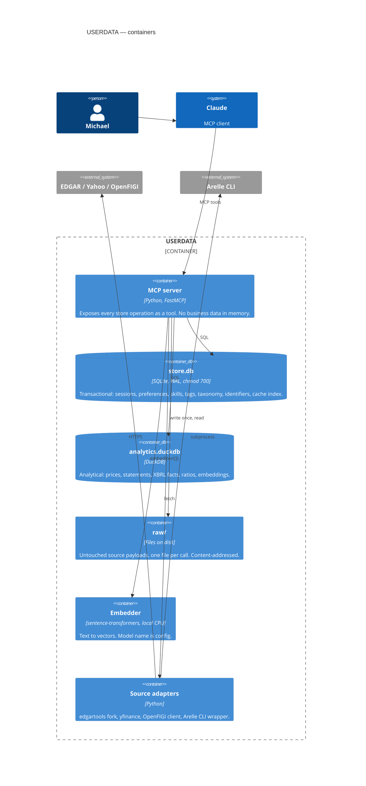
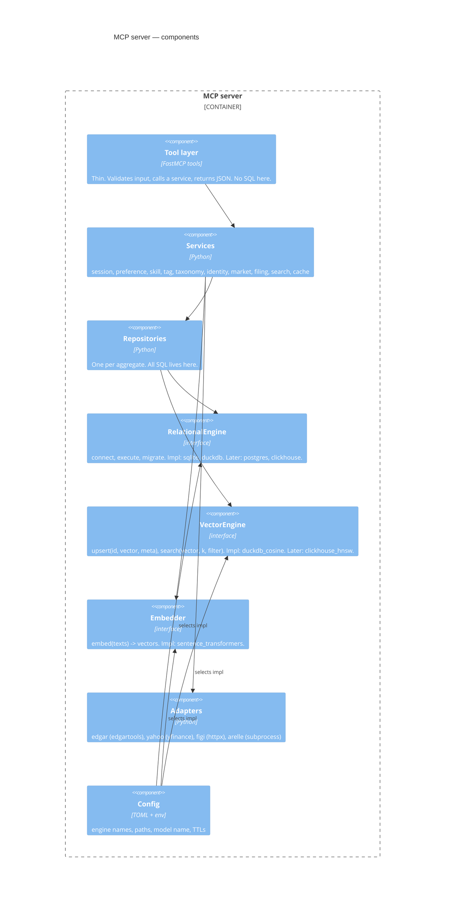
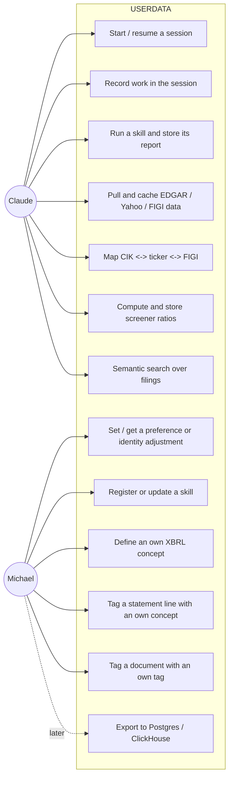
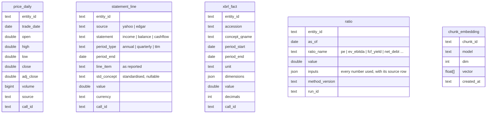
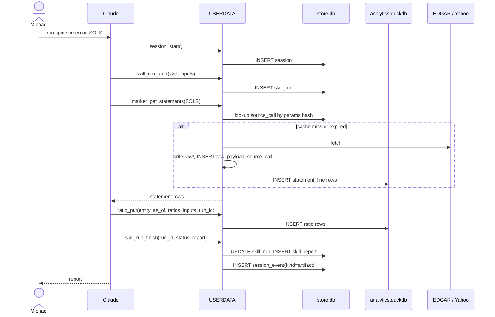
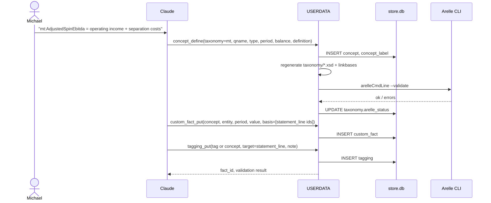
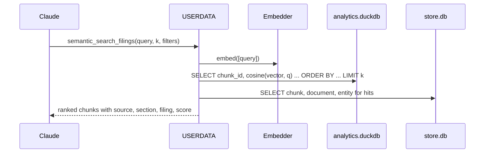
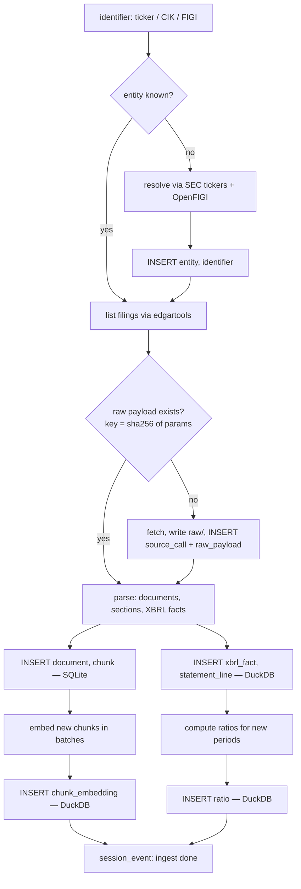
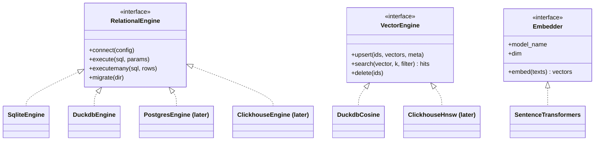

# USERDATA — Software Design Document

Draft 1, 2026-10-30. Author: Claude, for Michael Tabet. Status: for review.

Diagrams are Mermaid and render on GitHub. Decisions that are Michael's to
make are marked **DECIDE** and collected in §10.

---

## 1. Problem

The tools exist. `edgartools` reads SEC EDGAR and parses XBRL.
`yahoo-finance-mcp` reads prices and fundamentals. Arelle builds and
validates XBRL taxonomies. Claude can call all of them.

None of them keeps anything for the user. Every session starts empty.
Preferences are repeated, skill results are lost, custom XBRL work lives in
loose files, and the same filings are pulled again and again.

USERDATA is the missing piece: one MCP server that is the user's durable
store. Everything Michael does with Claude on this work lands in it and is
there next session.

### 1.1 Scope of v1

| In v1 | Designed for, not built |
|---|---|
| SQLite (transactional store) | Postgres (replaces SQLite) |
| DuckDB (analytical store + vectors) | ClickHouse (replaces DuckDB, native HNSW vectors) |
| Local embedding model | dbt (transforms over the analytical store) |
| MCP tools over stdio | Airflow (scheduled ingest), NiFi (visual flows) |
| Adapters: edgartools, yfinance, OpenFIGI, Arelle CLI | Unity Catalog (catalog), Superset (dashboards) |

### 1.2 Hard rules

1. Permissive licences only. CI fails on anything else.
2. Every write is durable. Kill the process, restart, everything is there,
   including vector search results.
3. No engine name inside a tool. Engine choice is config.
4. Additive schema changes only. Nothing in v1 blocks the later stack.

---

## 2. C4 Level 1 — System context



Claude is the only client in v1. Later clients (Airflow tasks, dbt, Superset)
talk to the stores directly, not through MCP, which is why the stores are
plain files with plain schemas.

---

## 3. C4 Level 2 — Containers



### 3.1 File layout

```
~/Slop/userdata-data/           chmod 700
├── store.db                    SQLite, journal_mode=WAL, synchronous=NORMAL
├── analytics.duckdb            DuckDB, single writer
├── raw/                        source payloads, sha256-named, never edited
│   ├── edgar/
│   ├── yahoo/
│   └── figi/
├── taxonomy/                   Michael's XBRL extension (.xsd, linkbases), Arelle output
└── models/                     downloaded embedding model
```

**DECIDE** data directory: `~/Slop/userdata-data` as above, or inside the
repo under `data/` (git-ignored).

### 3.2 Why two databases

DDIA chapter 3 separates OLTP (many small reads and writes by key) from
OLAP (few large scans and aggregates). The two workloads here are very
different:

| Workload | Shape | Engine | Later |
|---|---|---|---|
| Session events, preferences, skill registry, tags, taxonomy | small rows, by key, frequent writes, needs transactions | SQLite, row store, WAL | Postgres |
| Prices, statement lines, XBRL facts, ratios, embeddings | millions of rows, scanned by column, append-mostly | DuckDB, column store | ClickHouse |

DuckDB can read the SQLite file directly through its `sqlite` extension,
so analytical queries can join across both without copying.

---

## 4. C4 Level 3 — Components inside the MCP server



Rule 3 lives in `RelationalEngine` and `VectorEngine`. Swapping DuckDB for
ClickHouse is a config change plus a new engine class. Tools and services
do not change.

---

## 5. Use cases



Michael owns the meaning (preferences, skills, taxonomy, tags). Claude does
the mechanical work (sessions, pulls, runs, ratios, search). Both go through
the same tools.

---

## 6. Data model (DDIA chapter 2)

### 6.1 Modelling decisions

DDIA gives three models. Each entity below is assigned to one, with the
reason.

| Model | Used for | Why |
|---|---|---|
| **Relational** | entities, identifiers, skills, runs, tags, taxonomy, facts, prices | Many-to-many relationships and joins everywhere. Schema is known. SQL is what dbt, Superset and Airflow speak. |
| **Document** (JSON column inside a relational row) | preference values, skill props, session event payloads, raw cached responses, ratio inputs | Self-contained, read whole, schema varies per skill or per source. DDIA: locality, schema-on-read. Postgres `jsonb` and ClickHouse `JSON` take these later unchanged. |
| **Graph** (edge table, recursive CTE) | XBRL taxonomy relations (parent/child, calculation, presentation) | Small graph, variable depth, walked both ways. Edge table in SQL is enough. No graph database. |

Three further DDIA ideas shape the schema:

- **Event log.** Session work is an append-only log of events (ch. 11).
  Nothing in a session is updated in place; current state is derived.
- **Narrow fact table.** XBRL facts, statement lines, prices and ratios are
  stored long (one value per row) not wide (one column per concept). This
  is the columnar pattern (ch. 3) and the only shape that survives new
  concepts without schema changes.
- **Immutable raw, derived everything else.** Source payloads are written
  once, content-addressed, never changed. Every derived table can be rebuilt
  from them. This is what makes dbt and Airflow slot in later: they are
  just a different way of running the same derivations.

### 6.2 Entity-relationship diagram

```mermaid
erDiagram
  %% ---------- SQLite: store.db ----------
  user_profile ||--o{ preference : has
  user_profile ||--o{ session : opens
  session ||--o{ session_event : logs
  session ||--o{ skill_run : hosts

  skill ||--o{ skill_version : versions
  skill_version ||--o{ skill_run : executes
  skill_run ||--o| skill_report : produces

  entity ||--o{ identifier : identified_by
  entity ||--o{ document : files
  document ||--o{ chunk : split_into

  tag ||--o{ tagging : applied_in
  tagging }o--|| document : targets
  tagging }o--|| chunk : targets

  taxonomy ||--o{ concept : defines
  concept ||--o{ concept_relation : from
  concept ||--o{ concept_relation : to
  concept ||--o{ concept_label : labelled
  concept ||--o{ custom_fact : valued_as
  entity ||--o{ custom_fact : about
  skill_run o|--o{ custom_fact : asserted_by

  source_call ||--|| raw_payload : stored_as
  skill_run o|--o{ source_call : made

  user_profile {
    text user_id PK
    text display_name
    text created_at
  }
  preference {
    text user_id FK
    text scope "global | skill:<id> | entity:<id>"
    text key
    json value
    text updated_at
  }
  session {
    text session_id PK
    text user_id FK
    text started_at
    text ended_at
    text title
    json context "client, cwd, model"
  }
  session_event {
    int seq PK
    text session_id FK
    text at
    text kind "note | decision | tool_call | artifact | error"
    json payload
  }
  skill {
    text skill_id PK
    text name
    text purpose
    text created_at
  }
  skill_version {
    text skill_version_id PK
    text skill_id FK
    int version
    text source_path
    text content_sha256
    json props "schema-free settings"
    text created_at
  }
  skill_run {
    text run_id PK
    text skill_version_id FK
    text session_id FK
    text started_at
    text ended_at
    text status "ok | failed | partial"
    json inputs
  }
  skill_report {
    text run_id PK_FK
    text summary
    json body
    text artifact_path
  }
  entity {
    text entity_id PK
    text name
    text kind "company | fund | person | index"
    text sic
    text state_of_inc
  }
  identifier {
    text entity_id FK
    text scheme "cik | ticker | figi | cusip | isin | lei"
    text value
    text exchange
    text valid_from
    text valid_to
    text source
  }
  document {
    text document_id PK
    text entity_id FK
    text source "edgar | yahoo | user"
    text form
    text accession
    text filed_at
    text url
    text raw_sha256 FK
    text title
  }
  chunk {
    text chunk_id PK
    text document_id FK
    int ordinal
    text section
    text text
    int n_tokens
  }
  tag {
    text tag_id PK
    text name
    text namespace "mt | <skill_id>"
    text description
  }
  tagging {
    text tagging_id PK
    text tag_id FK
    text target_kind "document | chunk | statement_line | fact"
    text target_id
    text run_id FK
    text note
    text created_at
  }
  taxonomy {
    text taxonomy_id PK
    text namespace_uri
    text prefix "mt"
    text version
    text xsd_path
    text arelle_status "valid | invalid | unchecked"
  }
  concept {
    text concept_id PK
    text taxonomy_id FK
    text qname "mt:AdjustedSpinEbitda"
    text data_type
    text period_type "duration | instant"
    text balance "debit | credit | none"
    bool abstract
    text definition
  }
  concept_relation {
    text from_concept_id FK
    text to_concept_id FK
    text arcrole "parent-child | summation-item | ..."
    real weight
    int order_no
  }
  concept_label {
    text concept_id FK
    text role
    text lang
    text label
  }
  custom_fact {
    text fact_id PK
    text concept_id FK
    text entity_id FK
    text period_start
    text period_end
    text unit
    real value
    json dimensions
    text basis "which source facts / statement lines it came from"
    text run_id FK
    text created_at
  }
  source_call {
    text call_id PK
    text source "edgar | yahoo | figi"
    text endpoint
    json params
    text params_sha256
    text fetched_at
    int ttl_seconds
    text raw_sha256 FK
    int http_status
  }
  raw_payload {
    text raw_sha256 PK
    text path
    int bytes
    text content_type
  }
```



Cross-database keys (`entity_id`, `chunk_id`, `call_id`, `run_id`) are
text UUIDs generated once in SQLite. DuckDB does not enforce them; the
service layer does. ClickHouse has no foreign keys either, so this is the
right habit from day one.

### 6.3 Per-table rationale

Access pattern, cardinality, and normalise/denormalise choice for each.

**SQLite — transactional**

| Table | Access pattern | Cardinality | Shape | Why |
|---|---|---|---|---|
| `user_profile` | read once per session | 1 | relational | One user now; the key exists so multi-user later costs nothing. |
| `preference` | get by (scope, key); list by scope | user 1:N | relational key + document value | Key-value with scoping. Value is JSON because preferences vary in type. This is the "identity adjustment" store. |
| `session` | by id; list recent | user 1:N | relational | Small. Current state is derived from events. |
| `session_event` | append; read whole session in order | session 1:N | event log, JSON payload | Append-only (DDIA ch. 11). Never updated. |
| `skill`, `skill_version` | by id; list | skill 1:N versions | relational, JSON props | Versioned so a report always points at the exact skill text that produced it. `content_sha256` catches edits. |
| `skill_run` | by id; by session; by skill | version 1:N runs | relational | The lineage anchor. Facts, taggings, ratios and source calls all point back here. |
| `skill_report` | by run | run 1:1 | document | Read whole, written once. |
| `entity` | by id; by name search | — | relational | Thin. Identity lives in `identifier`. |
| `identifier` | find entity by (scheme, value); list ids for entity | entity 1:N, over time | relational, temporal | Tickers change, CIKs don't, FIGIs are many per entity. `valid_from/to` is the minimum temporal model. This is the CIK↔ticker↔FIGI map. |
| `document` | by entity + form; by accession | entity 1:N | relational | Points at the raw payload. Text is in `chunk`, not here. |
| `chunk` | by document ordered; by id from search hit | document 1:N | relational | The text unit for embedding and tagging. Section kept so filters work. |
| `tag`, `tagging` | tags on a target; targets with a tag | tag M:N targets | relational, polymorphic target | Document tagging is M:N. `target_kind` + `target_id` instead of four join tables: fewer tables, same queries. Namespace separates Michael's tags from skill-generated ones. |
| `taxonomy`, `concept`, `concept_label` | load all for a taxonomy; concept by qname | taxonomy 1:N concepts | relational | Mirrors XBRL's own structure so Arelle output round-trips. |
| `concept_relation` | children of X; parents of X; walk tree | concept M:N concept | graph as edge table | Variable depth, both directions. Recursive CTE in SQLite, Postgres and ClickHouse. |
| `custom_fact` | facts for entity + period; facts by concept | concept 1:N, entity 1:N | relational, long | This is "tagging a statement with my own concept": a value, an own concept, an entity, a period, and `basis` saying which source numbers it came from. Same shape as `xbrl_fact` on purpose, so the two can be unioned. |
| `source_call`, `raw_payload` | by (source, endpoint, params hash); expiry scan | call 1:1 payload | relational index + file | The cache. Content-addressed so identical responses are stored once. TTL on the index row, not the file. |

**DuckDB — analytical**

| Table | Access pattern | Shape | Why |
|---|---|---|---|
| `price_daily` | range scan by entity and date | long, append | Classic time series. Sorted by (entity_id, trade_date), which is the ClickHouse `ORDER BY` later. |
| `statement_line` | all lines for entity, statement, period; one line across periods | long | Wide tables break every time Yahoo or EDGAR adds a line item. Long never breaks. `std_concept` is the join key to `custom_fact`. |
| `xbrl_fact` | by entity, concept, period; dimension filter | long, JSON dims | Direct image of edgartools' fact output. Dimensions are JSON because the set of axes is open. |
| `ratio` | by entity, as_of; one ratio across entities | long | The analysis store. `inputs` holds every number used, so a ratio is auditable without recomputing. `method_version` lets a formula change without rewriting history. |
| `chunk_embedding` | nearest-k by vector, filter by chunk metadata via join | fixed-width array | v1 brute-force cosine over a few hundred thousand vectors is fine. `model` column so re-embedding is additive. |

### 6.4 Schema evolution

DDIA ch. 4: writers and readers will be on different versions. Rules:

1. **Additive only.** New columns are nullable or have defaults. No renames,
   no drops in v1. Removal is a two-step: stop writing, then drop a version
   later.
2. **Open fields are JSON.** `preference.value`, `skill_version.props`,
   `session_event.payload`, `ratio.inputs`, `*.dimensions`. New keys need no
   migration.
3. **Long tables absorb new concepts.** A new ratio, line item or XBRL
   concept is a new row, not a new column.
4. **Versioned migrations.** A `schema_migration` table in each database,
   files numbered `0001_*.sql`. Same files target Postgres and ClickHouse
   with dialect folders.
5. **Names are dbt-ready.** Tables above are the `raw`/`core` layer. dbt
   marts build on them later without touching them. Unity Catalog's
   three-level name becomes `userdata.core.<table>`.

### 6.5 SQLite vs DuckDB modelling consequences

| Topic | SQLite | DuckDB |
|---|---|---|
| Writes | many small, concurrent readers under WAL | one writer at a time; batch inserts |
| Types | loose; store dates as ISO text | strict; real `DATE`, `DOUBLE`, `FLOAT[384]` |
| Foreign keys | enforced (`PRAGMA foreign_keys=ON`) | not enforced |
| JSON | `json` functions, text storage | native `JSON` type |
| Vectors | needs extension (`sqlite-vec`) | native arrays + `array_cosine_similarity`; `vss` extension optional |

Consequence: the MCP server holds **one** DuckDB connection and serialises
writes to it. Reads from SQLite stay concurrent.

---

## 7. Sequence diagrams

### 7.1 A skill runs and its result is stored



### 7.2 Michael tags a statement line with his own concept



### 7.3 Semantic search over filings



---

## 8. Activity diagram — ingest a filing

The same flow runs from an MCP tool today and from an Airflow task later.
Every step is idempotent on its key.



---

## 9. Class diagram — only the engine boundary

The only classes worth drawing are the ones that let the engines change.



---

## 10. Decisions for Michael

1. **Data directory.** `~/Slop/userdata-data` or `data/` inside the repo.
2. **Embedding model.** `all-MiniLM-L6-v2` (Apache-2.0, 384 dims, fast) or
   `bge-small-en-v1.5` (MIT, 384 dims, better on retrieval benchmarks).
3. **Vector engine in v1.** DuckDB brute-force cosine (zero extra deps) or
   `sqlite-vec` (keeps vectors next to chunks in SQLite).
4. **MCP framework.** FastMCP 4.x (Apache-2.0, 28k stars) or the official
   SDK's bundled FastMCP (MIT). Your Yahoo fork uses the official SDK.
5. **Taxonomy prefix.** `mt` as drawn, or another.
6. **`unidecode` in edgartools.** It is GPL. Replace it in your fork with
   `anyascii` (ISC) before the licence gate goes in.

---

## 11. Risk register

| Risk | Impact | Mitigation |
|---|---|---|
| SQLite concurrent writers | locked database errors | WAL mode, one server process, short transactions |
| DuckDB single writer | second process cannot open for write | server owns the connection; later readers use `read_only=True` or ClickHouse |
| Session data on disk | leak of work history | directory `chmod 700`; no secrets ever stored (Bitwarden only) |
| Yahoo breaks or blocks | prices and fundamentals stop | everything cached; SEC XBRL frames API as fundamentals fallback |
| OpenFIGI rate limit without key | slow identifier resolution | SEC ticker file first; FIGI only when needed; optional key via `bws` |
| GPL dependency slips in | licence rule broken | `pip-licenses` in CI, fails on anything outside the allowed list |
| Embedding model change | old vectors incomparable | `model` column on `chunk_embedding`; re-embed is additive |
| ClickHouse later lacks FKs and transactions | integrity assumptions break | no cross-table FKs in DuckDB from day one; service layer owns integrity |

---

## 12. Licence matrix (v1 runtime dependencies)

| Dependency | SPDX | Verdict |
|---|---|---|
| Python 3.12+ | PSF-2.0 | allowed |
| fastmcp / mcp | Apache-2.0 / MIT | allowed |
| sqlite3 (stdlib) | Public Domain | allowed |
| duckdb | MIT | allowed |
| edgartools (fork) | MIT | allowed, after `unidecode` swap |
| yfinance | Apache-2.0 | allowed |
| sentence-transformers | Apache-2.0 | allowed |
| torch | BSD-3-Clause | allowed |
| httpx | BSD-3-Clause | allowed |
| pydantic | MIT | allowed |
| pandas, pyarrow | BSD-3-Clause / Apache-2.0 | allowed |
| anyascii (replaces unidecode) | ISC | allowed |
| unidecode | GPL-2.0-or-later | **excluded** |
| Arelle (external process, not a dependency) | Apache-2.0 | allowed |

Transitive dependencies are checked by the CI gate, not by hand.
